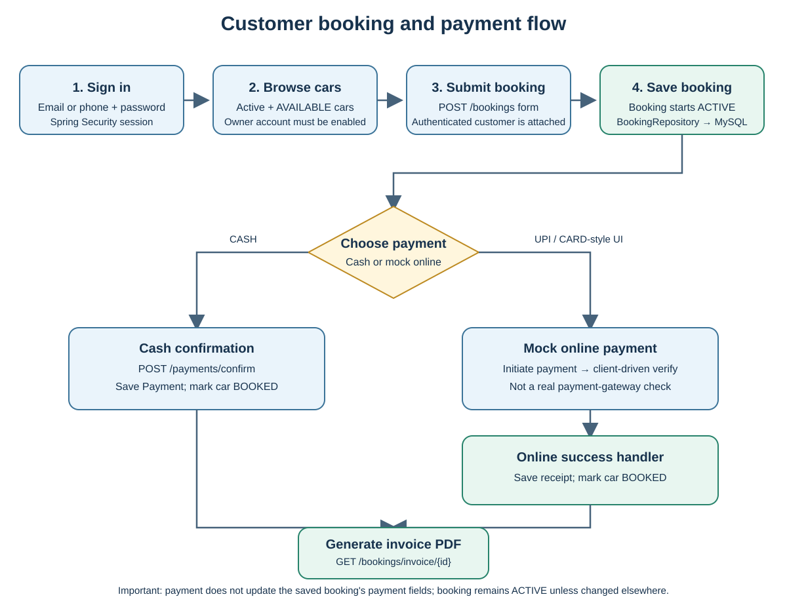
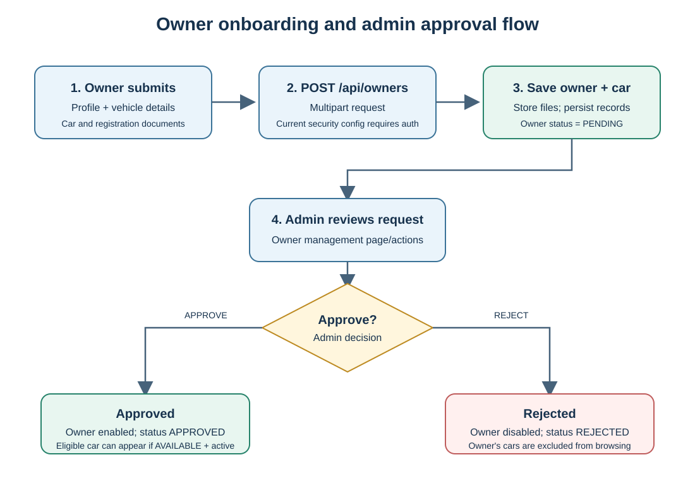
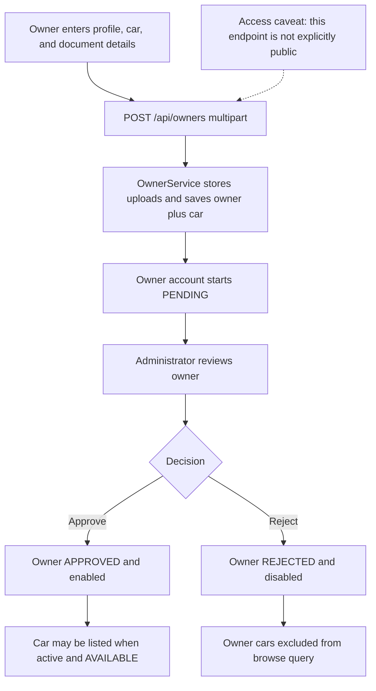
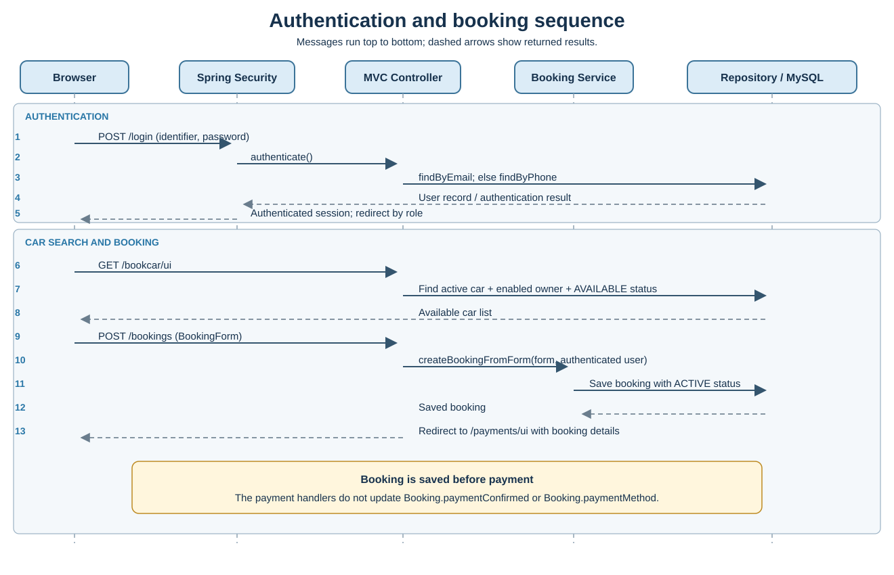
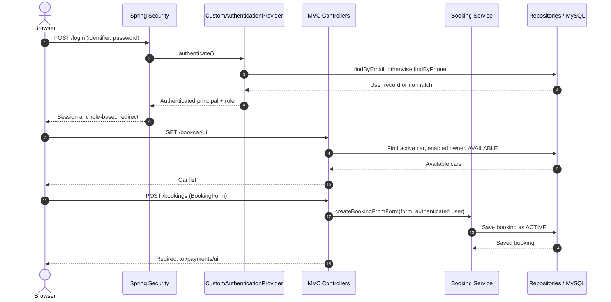
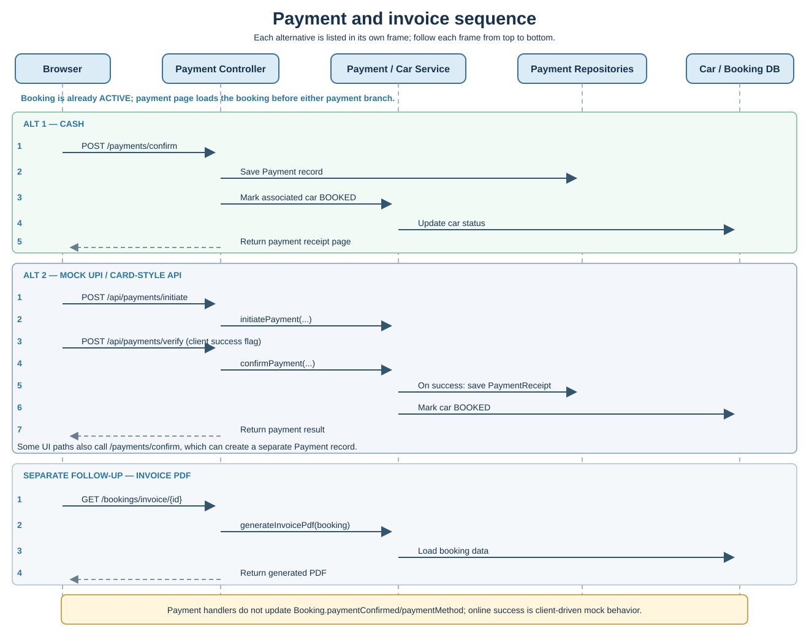
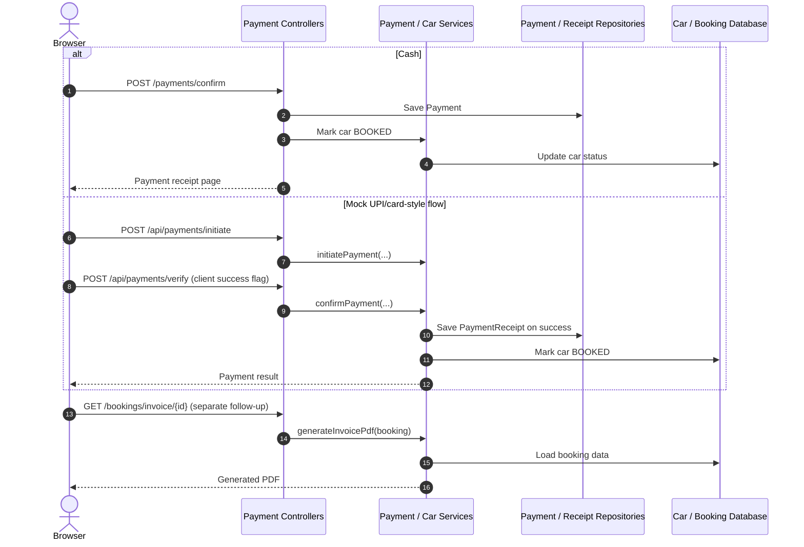

# Surya Car Pool flow and sequence diagrams

These diagrams follow the current Java controllers and services. The README and Postman collection contain older ride-sharing routes and do not match these flows.

## 1. Customer booking and payment flow



```mermaid
flowchart TD
    A[Sign in: email or phone] --> B[Browse active, AVAILABLE cars]
    B --> C[Select car and submit POST /bookings]
    C --> D[BookingServiceImpl saves ACTIVE booking]
    D --> E{Payment method}
    E -->|Cash| F[POST /payments/confirm]
    F --> G[Save Payment and mark car BOOKED]
    E -->|UPI / card-style UI| H[POST /api/payments/initiate]
    H --> I[POST /api/payments/verify with client success flag]
    I --> J[On success: save PaymentReceipt and mark car BOOKED]
    G --> K[GET /bookings/invoice/{id}]
    J --> K
    K --> L[InvoiceService generates PDF]
    M[Important: booking payment fields are not updated] -.-> D
```

## 2. Owner onboarding and administrator approval





## 3. Authentication and booking sequence





## 4. Payment and invoice sequence





## Source-linked caveats

- Booking is persisted as `ACTIVE` before payment. The payment handlers do not update the booking's `paymentConfirmed` or `paymentMethod` fields.
- The online flow is mock/client-driven; a client-supplied success value is not external payment verification.
- Payment initiation and some template actions reference endpoints or UI data that are missing/incomplete in the current repository.
- Owner submission endpoint access and owner password handling differ from the normal registration path.
